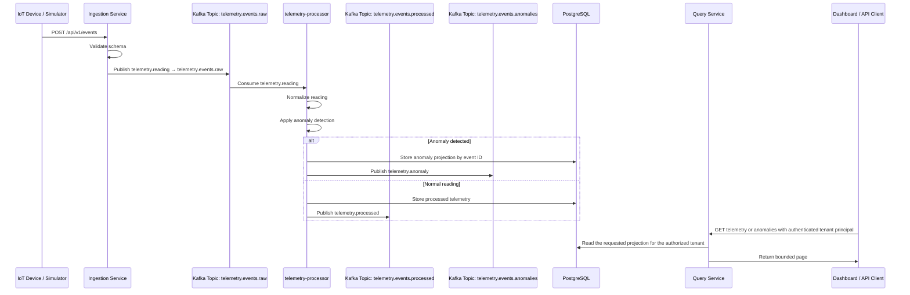

# Event Flow Diagram

This diagram illustrates the lifecycle of a telemetry event as it moves through the PulseStream platform.

**Notes:**

*   The platform receives telemetry over HTTP through the ingestion service.
*   Kafka decouples telemetry producers from downstream consumers.
*   The telemetry-processor applies anomaly detection rules asynchronously.
*   Normal processed telemetry is stored in PostgreSQL.
*   Events that fail processing are routed to `telemetry.events.dlq` and can be replayed back into the pipeline via a management endpoint on the telemetry processor.
*   Anomalies are persisted before Kafka publication and can be queried through the [anomaly API](../api/anomalies.md) (#267). Both it and the [processed telemetry API](../api/processed-telemetry.md) (#266) require the pending authenticated tenant integration. Cross-classification replay consistency remains #271.
